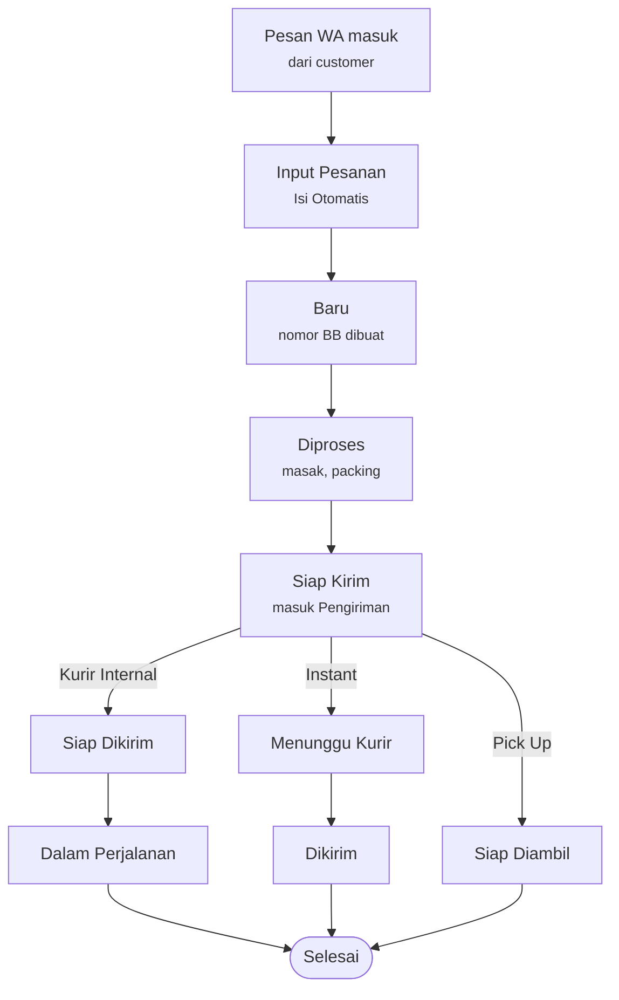

# PRD — Web Management POS

23 Oktober 2026 · jtengon@gmail.com
Versi online: https://claude.ai/artifact/Hjt7PaWfWPJ3JNktdaTgJa

## Ringkasan

Web Management POS adalah panel admin internal untuk **Burnt Butter & Segelas Awan**, usaha pasta panggang dan dessert yang menerima pesanan lewat WhatsApp. Versi pertama menyatukan input pesanan, produksi harian, pengiriman, stok, dan laporan dalam satu web app.

**Masalah yang dijawab desain.** Pesanan masuk sebagai teks WA bebas. Admin perlu tahu berapa porsi yang harus dimasak hari ini, pesanan mana yang siap dikirim dan oleh siapa, sisa stok packaging, serta total pemasukan, tanpa menyalin data berkali-kali.

**Tujuan v1**

- Mengubah pesan WA menjadi data pesanan terstruktur lewat tombol *Isi Otomatis*.
- Memberi admin gambaran harian: jumlah pesanan, porsi per menu, status, pembayaran, dan metode kirim.
- Mengatur pengiriman per metode (Kurir Internal, Instant, Pick Up) beserta kurir dan slot jam.
- Menyajikan laporan periode untuk owner: tren pesanan, produk terlaris, metode bayar.
- Menjaga master data menu, packaging, bahan baku, kurir, metode bayar, dan user.

**Cakupan layar**

| Layar | Status desain | File |
| --- | --- | --- |
| Dashboard | Ada | [design/01-dashboard.png](design/01-dashboard.png) |
| Input Pesanan (modal tempel WA) | Ada | [design/02-input-pesanan-modal.png](design/02-input-pesanan-modal.png) |
| Pesanan (daftar + panel detail) | Ada | [design/03-pesanan.png](design/03-pesanan.png) |
| Pengiriman (daftar + panel detail + peta) | Ada | [design/04-pengiriman.png](design/04-pengiriman.png) |
| Laporan (tab Ringkasan) | Ada | [design/05-laporan.png](design/05-laporan.png) |
| Master Data | Ada | [design/06-master-data.png](design/06-master-data.png) |
| Pembayaran, Stok Packaging, Produksi | Belum ada, hanya di navigasi | — |
| Form hasil Isi Otomatis, Detail Lengkap pesanan, notifikasi, login | Belum ada | — |

Latar beige dengan ilustrasi box pasta ([design/bg-beige-brand.png](design/bg-beige-brand.png)) dipakai sebagai aset brand untuk header dan halaman kosong.

**Di luar cakupan v1 (usulan):** pemesanan mandiri oleh customer, payment gateway online, integrasi API WhatsApp Business (v1 cukup salin-tempel), dan multi-outlet.

## Pengguna & peran

Master Data › User / Staff menampilkan empat peran: Admin, Kasir (Staff), Produksi (Staff), dan Owner. Desain belum menentukan hak akses tiap peran, jadi tabel di bawah adalah usulan yang perlu dikonfirmasi.

| Peran | Kebutuhan utama | Akses usulan |
| --- | --- | --- |
| Admin | Input dan kelola pesanan harian, atur pengiriman | Semua modul, termasuk User / Staff dan Pengaturan |
| Kasir (Staff) | Catat pesanan dari WA, konfirmasi pembayaran | Dashboard, Pesanan, Input Pesanan, Pembayaran, Pengiriman |
| Produksi (Staff) | Tahu porsi per menu dan stok yang menipis | Dashboard (Rekap Produksi), Produksi, Stok Packaging, Bahan Baku (lihat + ubah stok) |
| Owner | Pantau performa bisnis | Laporan, Dashboard; Master Data hanya lihat |

Kurir (Andi, Budi) tercatat sebagai data di Master Data, bukan pengguna yang login.

## Kebutuhan fungsional

Setiap modul diturunkan langsung dari elemen di gambar desain. Kode F-xx dipakai untuk menautkan tiket pengembangan.

### Global

- **F-01** Top navbar: Dashboard, Pesanan, Pembayaran, Stok Packaging, Produksi, Pengiriman, Laporan, Master Data. Menu aktif diberi latar dan garis bawah cokelat.
- **F-02** Tombol **+ Input Pesanan** selalu tampil di navbar dan membuka modal Input Pesanan dari halaman mana pun.
- **F-03** Ikon notifikasi dengan titik merah untuk item belum dibaca; menu profil (avatar, nama, dropdown).
- **F-04** Semua kartu KPI menampilkan nilai, sparkline, dan badge perubahan (hijau naik, merah turun) dibanding periode sebelumnya.

### Dashboard

- **F-10** Sapaan "Halo, {nama}!" dan pemilih tanggal (default hari ini).
- **F-11** Filter periode: Hari Ini, 7 Hari, 30 Hari, Bulan Ini (dropdown).
- **F-12** KPI: Total Pesanan, Pesanan Personal, Pesanan Hadiah, Total Pembayaran.
- **F-13** Daftar Pesanan Terbaru (5 baris): No. Pesanan, Waktu, Nama, Tipe, Total, Status, menu aksi; tombol Lihat Semua ke halaman Pesanan.
- **F-14** Donat Pesanan per Tipe (Personal vs Hadiah, jumlah + persen).
- **F-15** Bar Status Pesanan Hari Ini: Baru, Diproses, Siap Kirim, Dikirim, Selesai.
- **F-16** Grafik garis Total Pembayaran 7 hari terakhir + Lihat Detail ke Laporan › Pembayaran.
- **F-17** Pesanan per Metode Pengiriman: Pick Up, Instant, Kurir Internal (jumlah, persen, bar).
- **F-18** Rekap Produksi Hari Ini: foto menu + total porsi/pcs per menu dari pesanan yang dikirim hari itu.
- **F-19** Stok Packaging (Ringkas): stok saat ini / kapasitas dengan bar berwarna (hijau, kuning, merah).

### Input Pesanan

- **F-20** Modal berisi area teks untuk menempel pesan WA, tombol **Isi Otomatis**, dan **Reset**.
- **F-21** Isi Otomatis mem-parsing teks menjadi: nama, no. telp, alamat, tanggal kirim, metode pengiriman, request, tipe (Personal/Hadiah), dan item menu + ukuran + jumlah.
- **F-22** Hasil parsing tampil di form yang bisa diedit; field yang tidak terbaca ditandai agar diisi manual. Form ada di halaman `/pesanan/baru` (pesan WA di kiri, form di kanan); Isi Otomatis di modal membawa pesan ke halaman ini. Desainnya diputuskan saat implementasi (lihat DESIGN.md).
- **F-23** Simpan membuat pesanan berstatus **Baru** dengan nomor otomatis `BB` + `YYMMDD` + urutan 3 digit (contoh BB261021001).
- **F-24** Total dihitung dari harga master menu sesuai ukuran.

### Pesanan

- **F-30** KPI periode: Total Pesanan, Personal, Hadiah, Total Pembayaran.
- **F-31** Filter: cari (nama, no. pesanan, no. telp), rentang tanggal, tipe, status, metode pengiriman, Reset.
- **F-32** Tabel dengan checkbox, No. Pesanan, Waktu, Nama Customer, Tipe, Tgl Kirim, Pengiriman, Total, Status, menu aksi; paginasi 10 baris ("Menampilkan 1–10 dari 24 pesanan").
- **F-33** Klik baris membuka panel Detail Pesanan: nomor + status, waktu dibuat, Data Customer (bisa Edit), Daftar Menu dengan foto dan qty, Total Pembayaran.
- **F-34** Aksi panel: dropdown **Ubah Status** dan **Lihat Detail Lengkap** (halaman belum didesain).
- **F-36** Input Pesanan punya tiga sumber: WhatsApp (template), Shopee, dan Tokopedia. Marketplace diisi lewat form manual: no. pesanan (ditolak bila sudah pernah diinput), total sesuai marketplace, kurir, dan resi. Pesanan otomatis Lunas via Shopee/Tokopedia, memakai metode kirim Ekspedisi, dan resi wajib diisi sebelum Tandai Dikirim.
- **F-37** Admin dan Kasir bisa menambah catatan per pesanan (mis. add-on pembeli) dari menu Pesanan. Catatan berupa teks, tidak mengubah total, dan terlihat di semua menu yang menampilkan pesanan, termasuk Dashboard dan Produksi.
- **F-35** Checkbox memungkinkan aksi massal. Pesanan: ubah status, tandai lunas (satu metode untuk semua), batalkan, unduh CSV. Pengiriman: atur kurir & jadwal, tandai dikirim. Pesanan yang tidak memenuhi syarat dilewati dan disebutkan.

### Pengiriman

- **F-40** KPI: Perlu Dikirim Hari Ini, Kurir Internal, Instant, Pick Up, Selesai Dikirim Hari Ini.
- **F-41** Tab: Semua, Perlu Dikirim, Dalam Perjalanan, Selesai (dengan jumlah); filter tanggal, metode, kurir, status.
- **F-42** Tabel: No. Pesanan, Nama Customer, Metode (ikon), Alamat (dipotong), Kurir, Estimasi slot jam, Status.
- **F-43** Status pengiriman: Menunggu Kurir, Siap Dikirim, Siap Diambil, Dalam Perjalanan, Dikirim, Selesai.
- **F-44** Panel Detail Pengiriman: info customer, alamat, tanggal, metode + catatan slot ("Pengiriman jam 09.00–17.00"), request, peta mini dengan rute dan tombol **Lihat Rute di Maps**, Daftar Menu.
- **F-45** Aksi: **Tandai Dikirim**, **Ubah Kurir / Jadwal**, **Lihat Pesanan**. Terimplementasi: tombol utama mengikuti tahap (Tandai Dikirim → Tandai Selesai; Pick Up: Sudah Diambil). Pesanan yang belum selesai dimasak belum bisa dikirim, dan Kurir Internal wajib dipilih kurirnya dulu.
- **F-46** Kurir Internal punya slot 09:00–12:00 dan 13:00–17:00; Instant dan Pick Up tanpa kurir dan slot.

### Laporan

- **F-50** Rentang tanggal + preset (Bulan Ini). Tab: Ringkasan, Penjualan, Produk, Produksi, Pengiriman, Pembayaran, Stok Packaging, Customer. Hanya Ringkasan yang didesain. Terimplementasi: tab Ringkasan, default Bulan Ini, rentang menurut tanggal pesanan dibuat (WIB), tren dibanding periode sepanjang rentang yang sama tepat sebelumnya.
- **F-51** KPI Ringkasan: Total Pesanan, Total Produk Terjual (porsi), Total Pembayaran, Total Customer.
- **F-52** Tren Pesanan harian, garis Personal vs Hadiah.
- **F-53** Donat Distribusi per Metode Pengiriman (Kurir Internal, Instant, Pick Up, Lainnya) dan donat Status Pesanan.
- **F-54** Produk Terlaris top 5: menu + ukuran, total terjual, persentase.
- **F-55** Rekap Penjualan per Hari: bar bertumpuk Personal/Hadiah dengan toggle Pesanan / Pendapatan.
- **F-56** Metode Pembayaran: Transfer Bank, E-Wallet, Cash, Lainnya (persen) + total periode dan perubahan dari periode sebelumnya.

### Master Data

Sidebar: Produk & Menu, Stok Packaging, Bahan Baku, Kurir & Pengiriman, Metode Pembayaran, Customer, User / Staff, Pengaturan. Tiap tabel punya tombol Tambah, ikon edit, dan menu aksi.

- **F-60** Produk & Menu: foto, nama, deskripsi singkat, kategori (Pasta, Dessert, Bundle), ukuran (Large/Regular atau tanpa ukuran), harga per ukuran, status Aktif; cari + filter kategori.
- **F-61** Stok Packaging: foto, nama, stok, satuan, status Cukup/Menipis.
- **F-62** Bahan Baku: nama, satuan, stok saat ini, stok minimum, status Cukup/Menipis/Habis. Rumus sama dengan packaging: Habis bila stok 0, Menipis bila stok ≤ minimum, selain itu Cukup. Stok boleh pecahan (2 angka di belakang koma, mis. 2,5 kg) dan dicatat lewat masuk/keluar/hitung ulang oleh Admin dan Produksi.
- **F-63** Kurir & Pengiriman: nama, tipe (Kurir Internal/Eksternal), no. telp, status.
- **F-64** Metode Pembayaran: nama, tipe (Bank, E-Wallet, Cash), status.
- **F-65** User / Staff: nama, role, status.
- **F-66** Customer dan Pengaturan (desain belum ada; isi diputuskan saat implementasi, lihat DESIGN.md). Customer: nama, no. HP (kunci unik), alamat, jumlah pesanan, total belanja, pesanan terakhir; cari nama/no. HP; dikelola Admin dan Kasir, dilihat Owner, tidak untuk Produksi. Pengaturan (Admin): profil toko, yaitu nama toko, no. WhatsApp, alamat pick-up, dan link Google Maps.

### Modul tanpa desain

- **F-70** Pembayaran: status bayar per pesanan (Lunas / Belum bayar), dibayar lewat apa (metode dari Master Data), dan catatan. Tanpa DP dan tanpa unggah bukti transfer (keputusan pemilik toko, Okt 2026).
- **F-71** Produksi: rekap porsi per menu dan ukuran per tanggal kirim, serta papan pesanan Belum mulai / Sedang dimasak / Selesai masak. Mulai masak = Diproses, selesai masak = Siap Kirim. Role Produksi boleh mengubah status, tapi hanya untuk langkah dapur ini.
- **F-72** Stok Packaging: stok masuk, keluar, dan hitung ulang (stok opname) beserta riwayatnya. **Dicatat manual dulu** (keputusan pemilik toko, Okt 2026); stok tidak terpotong otomatis oleh pesanan.

## Alur pengguna

Semua pesanan melewati status yang sama sampai Siap Kirim; setelah itu status pengiriman mengikuti metode kirim dan semuanya berakhir di Selesai.

Kasir menempel chat WA, sistem membuat pesanan Baru, tim Produksi memprosesnya, lalu Admin mengatur kurir atau menunggu customer mengambil. Label status di desain belum seragam (lihat Pertanyaan terbuka).

## Model data

Pesanan adalah entitas pusat: satu pesanan punya satu customer, banyak item menu, satu pengiriman, dan satu atau lebih pembayaran. Field di bawah diambil dari kolom yang tampil di desain.

| Entitas | Field utama | Relasi |
| --- | --- | --- |
| Order (Pesanan) | no_pesanan, waktu_dibuat, tipe (Personal/Hadiah), tgl_kirim, status, total, request, raw_wa_text | → Customer, → OrderItem[], → Shipment, → Payment[] |
| OrderItem | menu_id, ukuran, qty, harga_satuan, subtotal | → Order, → Menu |
| Customer | nama, no_telp, alamat | → Order[] |
| Menu | nama, deskripsi, foto, kategori, harga per ukuran, status | → OrderItem[] |
| Shipment (Pengiriman) | metode (Kurir Internal/Instant/Pick Up), kurir_id, slot_jam, status_kirim, koordinat alamat | → Order, → Courier |
| Courier | nama, tipe (Internal/Eksternal), no_telp, status | → Shipment[] |
| Payment | metode_id, nominal, status, bukti, waktu | → Order, → PaymentMethod |
| PaymentMethod | nama, tipe (Bank/E-Wallet/Cash), status | → Payment[] |
| Packaging | nama, foto, stok, kapasitas, satuan | → StockMovement[] |
| RawMaterial (Bahan Baku) | nama, satuan, stok, stok_minimum | → StockMovement[] |
| StockMovement | item, jenis (masuk/keluar), qty, ref_order, waktu | → Packaging / RawMaterial |
| User | nama, role (Admin/Staff/Owner), status | — |

Status pesanan: Baru → Diproses → Siap Kirim → Dikirim → Selesai. Status pengiriman berjalan terpisah dan menggerakkan status pesanan (lihat Alur pengguna).

## Kebutuhan non-fungsional

Aplikasi dipakai di laptop admin saat jam operasional, jadi prioritasnya kecepatan input dan konsistensi visual dengan brand.

- **Desain visual:** palet cokelat burnt butter di atas krem/beige, sudut membulat, ikon garis, aksen tulisan tangan "Good Food Brighter Days". Warna status konsisten: Baru biru, Diproses kuning, Siap Kirim hijau, Dikirim abu, Selesai hijau; Personal oranye muda, Hadiah merah muda.
- **Responsif:** desain dibuat untuk desktop 1536 px. Tablet perlu didukung untuk staf produksi; navbar 8 menu harus dilipat di layar kecil.
- **Format lokal:** Bahasa Indonesia, Rupiah "Rp 4.780.000", tanggal "21 Oktober 2026" / "21/10/2026", zona waktu WIB.
- **Kinerja:** daftar dan dashboard tampil di bawah 2 detik untuk 1 bulan data (usulan).
- **Keamanan:** login per user, hak akses per role, log perubahan status pesanan (siapa dan kapan).
- **Keandalan parsing:** teks WA asli disimpan bersama pesanan agar bisa dicek ulang bila hasil Isi Otomatis keliru.
- **Aksesibilitas:** status tidak hanya dibedakan warna (ikon + teks sudah ada di desain), kontras teks pada latar krem minimal 4.5:1.

## Metrik, rilis, dan pertanyaan terbuka

V1 dianggap berhasil bila semua pesanan WA tercatat di sistem dan admin tidak lagi memakai catatan terpisah. Target di bawah adalah usulan untuk disepakati.

| Metrik | Target usulan |
| --- | --- |
| Pesanan WA yang tercatat di sistem | 100% sejak minggu ke-2 |
| Waktu input satu pesanan (tempel → simpan) | < 1 menit |
| Field terisi benar oleh Isi Otomatis | ≥ 90% |
| Pesanan terkirim sesuai slot jam | ≥ 95% |
| Kejadian packaging habis tanpa peringatan | 0 per bulan |

### Rilis bertahap (usulan)

1. **Fase 1 — Operasional inti:** login dan role, Master Data (menu, kurir, metode bayar, user), Input Pesanan + Isi Otomatis, Pesanan, Dashboard.
2. **Fase 2 — Pengiriman & pembayaran:** halaman Pengiriman dengan peta dan slot, modul Pembayaran.
3. **Fase 3 — Stok & produksi:** Stok Packaging, Bahan Baku, modul Produksi, peringatan stok menipis.
4. **Fase 4 — Laporan:** tab Ringkasan, lalu tujuh tab lainnya.

### Pertanyaan terbuka

Inkonsistensi di desain:

- [ ] Menu **Pengiriman** tidak ada di navbar layar Dashboard, Input Pesanan, dan Pesanan, tapi ada di tiga layar lain. Pakai navbar 9 menu di semua layar?
- [ ] Label status "Siap Kirim" (Pesanan) vs "Siap Dikirim" (Pengiriman). Apa beda "Dalam Perjalanan" dan "Dikirim"? *Sementara (Okt 2026): Siap Kirim = status pesanan, Siap Dikirim = status pengiriman Kurir Internal. Kurir Internal yang sedang mengantar = Dalam Perjalanan; Instant yang sudah diambil ojol = Dikirim. Keduanya masuk tab Dalam Perjalanan.*
- [ ] Dashboard di balik modal Input Pesanan punya kartu KPI berbeda (ada "Pesanan Selesai"). Versi mana yang final? *Sementara: versi desain utama (Total Pembayaran).*
- [ ] Angka contoh tidak saling cocok (tab Pengiriman 12 + 3 + 10 ≠ 22; Pick Up 10 di Dashboard vs 2 di Pengiriman). Perlu definisi rumus tiap KPI.
- [ ] Laporan menampilkan metode pengiriman "Lainnya" (15 pesanan). Apakah ini kurir eksternal seperti Citra Express?

Aturan bisnis yang belum jelas:

- [x] Format pesan WA yang dipakai customer: ada template baku atau teks bebas? **Template baku, dua jenis (Personal dan Hadiah)**; teksnya ada di `src/lib/wa-parser/templates.ts`.
- [x] Pesanan Hadiah butuh data tambahan (nama penerima, kartu ucapan, alamat berbeda)? **Ya**: Nama Penerima, No. Telp, Alamat (penerima), Nama Pengirim, dan kartu ucapan To / Wishes / From.
- [x] Pesanan Hadiah: siapa yang dicatat sebagai customer, penerima (nomornya ada di template) atau pengirim (nomor WA chat, tidak ada di template)? **Penerima.** Nama pengirim dan kartu ucapan disimpan di pesanan.
- [x] Bundle of 3: isinya bebas pilih 3 menu atau tetap? Template hanya meminta jumlah bundle. **Cukup jumlah**: satu item Rp 180.000; permintaan isi ditulis di Request.
- [x] Pembayaran: status saat pesanan disimpan? **Belum bayar.** Pembayaran dicatat terpisah di modul Pembayaran (tabel `payments`); status bayar dihitung dari situ. **Status bayar cukup Lunas / Belum bayar (tanpa DP)**, ditambah dibayar lewat apa (metode dari Master Data) dan catatan.
- [x] Ambang status bahan baku: Keju 8/10 = Menipis tapi Saus 6/10 = Habis. Rumusnya apa? **Habis bila 0, Menipis bila ≤ minimum, selain itu Cukup (Saus 6/10 = Menipis).**
- [x] Stok packaging dipotong saat pesanan dibuat, diproses, atau dikirim? Kapasitas (200, 100) disimpan di mana? **Manual dulu**: Admin/Produksi mencatat stok masuk/keluar sendiri. Kapasitas dan stok minimum diatur per packaging di Master Data.
- [x] Rekap Produksi dihitung per tanggal kirim atau tanggal pesan? **Per tanggal kirim.** "Selesai masak" = status pesanan Siap Kirim.
- [x] Aksi massal apa yang dibutuhkan dari checkbox di tabel Pesanan dan Pengiriman? **Pesanan: ubah status, tandai lunas, batalkan, unduh CSV. Pengiriman: atur kurir & jadwal, tandai dikirim.**
- [x] Bundle of 3 ("pilih 3 menu favorit"): pilihan menunya dicatat per pesanan? **Tidak; cukup jumlah bundle.** Isi yang diminta ditulis di Request, dan Rekap Produksi menampilkan Bundle of 3 sebagai satu baris.
